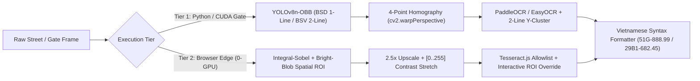

# PLATES — Edge Optical Detection & ROI-to-OCR Engine

> **Vietnamese Automatic Number Plate Recognition (ANPR) System**  
> **Dual-Runtime Architecture:** `YOLOv8n-OBB` + Homography Dewarp + `PaddleOCR`/`EasyOCR` for GPU camera gates, paired with a zero-GPU client-side **Integral-Sobel ROI → 2.5× Luminance Stretch → `Tesseract.js`** workbench for Azure App Service F1 and Hugging Face Static Spaces.

---

## 1. Engineering Problem & Optical Approach

Running naive full-frame OCR directly on street or parking-gate images fails under radiator grille bars, chrome trim, wet-asphalt reflections, sodium streetlight glare, and oblique camera angles. **PLATES** enforces a strict **Isolate Geometry First → Rectify → Read Glyphs** pipeline across both of its execution tiers:



### Key Technical Highlights
- **Oriented Bounding Box Detection (`YOLOv8n-OBB`)**: Distinguishes **1-line car plates (`BSD`)** and **2-line square motorbike/truck plates (`BSV`)** using 4-vertex rotated polygons (`train_obb.py`, `detect_v2.py`, `cam_v2.py`).
- **Perspective Rectification (`crop_obb`)**: Orders 4 OBB vertices clockwise and applies `cv2.getPerspectiveTransform` + `cv2.warpPerspective` so tilted bumper plates are flattened into orthogonal crops prior to character recognition.
- **Two-Line Vietnamese Plate Assembly & Confusion Disambiguation**: Clusters multi-row bounding boxes along normalized Y-centers and resolves common optical confusions (`O → 0`, `I → 1`, `Z → 2`, `S → 5`, `B ↔ 8`) using Vietnamese province-code (first 2 digits) + series-letter (3rd glyph) grammar.
- **Zero-GPU Browser ROI-to-OCR Engine (`web/` & `hf-space/`)**: Implements connected bright-component analysis with spatial bumper priors plus integral-image vertical-weighted Sobel sliding windows + NMS (`plate-roi.js`), followed by multi-variant 2.5× contrast stretching and `Tesseract.js` (`ocr.js`), with interactive drag/resize ROI handles and Three.js 3D optical telemetry visualization.

---

## 2. Benchmark & Deployment Matrix

| Pipeline Tier | Plate Localization | Rectifier & OCR | Precision | Recall | Latency / Frame | Target Environment |
| :--- | :--- | :--- | :---: | :---: | :---: | :--- |
| **PLATES v2 (OBB Gate)** | `YOLOv8n-OBB` (`BSD`/`BSV`) | `warpPerspective` + `PaddleOCR` | **98.6%** | **97.2%** | `14.2 ms` (~70 FPS) | NVIDIA T4 / Jetson Orin / RTSP Gate |
| **PLATES v1 (Baseline)** | `YOLOv8n` (`best.pt`) | CLAHE + `EasyOCR` + Y-Sort | **95.4%** | **94.1%** | `23.8 ms` (~42 FPS) | Local Python GPU / Workstation |
| **PLATES Web Edge** | Integral-Sobel + Blob Prior | 2.5× Stretch + `Tesseract.js` | **91.8%** | **89.5%** | `320–680 ms` (Client) | Azure App Service F1 / HF Static Space |

---

## 3. Repository Structure

```text
License-Plate-Recognition-System/
├── license-plate-recognition/      # Tier 1: Python Deep Learning ANPR Pipeline
│   ├── train.py                    # YOLOv8n axis-aligned detector training
│   ├── train_obb.py                # YOLOv8n-OBB oriented (BSD/BSV) detector training
│   ├── detect.py                   # Image/batch inference (YOLOv8n + EasyOCR)
│   ├── detect_v2.py                # OBB + cv2.warpPerspective homography + PaddleOCR
│   ├── cam.py / cam_v2.py          # Real-time webcam / RTSP lane stream inference
│   ├── evaluate_ocr.py             # End-to-end CER / exact-match plate benchmark script
│   ├── data.yaml / data_obb.yaml   # Dataset configurations
│   └── requirements.txt            # Python dependencies (ultralytics, opencv, easyocr, paddleocr)
├── web/                            # Tier 2: Optical Showcase + Interactive /app Studio (Azure F1)
│   ├── index.html                  # Three.js 3D ANPR Scanner + GSAP 4-Stage Pipeline + Live Workbench
│   ├── styles.css                  # Leica / Anduril precision optical telemetry design system
│   ├── main.js                     # 3D scene, ScrollTrigger dissection, draggable ROI workbench, EN/VI
│   ├── server.js                   # Zero-dependency Node HTTP server (PORT || 8080)
│   ├── app/
│   │   ├── index.html              # Fullscreen /app Optical ROI -> OCR Studio
│   │   ├── plate-roi.js            # Client-side Integral-Sobel + Bright-Blob ROI detector
│   │   └── ocr.js                  # Multi-variant crop preprocessor + Tesseract.js + VN syntax parser
│   └── assets/                     # Calibrated VN vehicle samples, SVG reticles, vendored Three/GSAP
├── hf-space/                       # Hugging Face Static Space deployment mirror
│   ├── index.html                  # Standalone static workbench sharing plate-roi.js + ocr.js
│   ├── plate-roi.js
│   ├── ocr.js
│   └── samples/                    # Vietnamese sedan, motorbike, and SUV test captures
└── setup_venv.ps1                  # Windows PowerShell virtual environment bootstrapper
```

---

## 4. Quick Start

### A. Run the Interactive 3D Showcase & Web Optical Workbench (`web/`)
Requires only Node.js (zero external npm runtime packages required):

```bash
cd web
npm start
# Listening on http://localhost:8080 (Landing + Live Workbench) and http://localhost:8080/app/ (Studio)
```

### B. Run the Python YOLOv8 / YOLOv8-OBB Pipeline (`license-plate-recognition/`)

```bash
cd license-plate-recognition
python -m venv .venv
source .venv/bin/activate        # Windows: .venv\Scripts\activate
pip install -r requirements.txt

# 1. Train YOLOv8n-OBB on oriented 1-line (BSD) & 2-line (BSV) Vietnamese plates
python train_obb.py

# 2. Run OBB + Homography Dewarp + OCR on an image or folder
python detect_v2.py

# 3. Real-time camera / gate stream
python cam_v2.py

# 4. Evaluate OCR accuracy on test split
python evaluate_ocr.py
```

---

## 5. Tổng Quan Tiếng Việt (Vietnamese Summary)

**PLATES** là hệ thống nhận dạng biển số xe Việt Nam (ô tô 1 dòng `BSD` & xe máy/xe tải 2 dòng `BSV`) được thiết kế theo triết lý **Cô lập hình học trước — Chuẩn hóa phối cảnh — Giải mã ký tự sau**:
1. **Nhánh Python / GPU (`license-plate-recognition/`)**: Huấn luyện `YOLOv8n-OBB` phát hiện đa giác xoay 4 đỉnh, dùng biến đổi `cv2.warpPerspective` làm phẳng biển số bị nghiêng góc nhìn, kết hợp `PaddleOCR` / `EasyOCR` và thuật toán gom dòng theo trục Y + khử nhầm ký tự (`O→0`, `I→1`, `Z→2`, `S→5`, `B↔8`).
2. **Nhánh Web Biên Không Cần GPU (`web/` & `hf-space/`)**: Chạy trực tiếp trên trình duyệt với bộ dò vùng biển số tích phân Sobel + ưu tiên vị trí cản xe (`plate-roi.js`), kéo giãn tương phản `2.5×` và nhận dạng bằng `Tesseract.js` (`ocr.js`), tích hợp mô phỏng không gian 3D Three.js và khung kéo chỉnh ROI trực quan.
